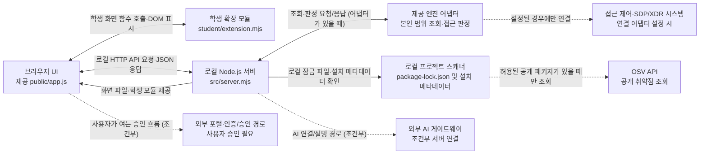

# Lumos 학생용 실행 설명서·구성도

> 이 문서는 학생 문서로 새로 작성했습니다. 기존 README와 제공 안내서는 덮어쓰지 않았습니다. 이 작업 공간에서 학생이 부르는 Agent 이름은 **Lumos**입니다. 시작 틀의 파일·폴더 이름과 실행 중 표시되는 기본 앱 이름은 자동으로 Lumos로 바뀌지 않습니다. 실행 도구가 출력하는 이름은 현재 기본 이름인 케셰브일 수 있습니다.
>
> 21·22단계의 커밋 원문 제출 흐름은 [학생용 제출 준비 메모](STUDENT_SUBMISSION_GUIDE.md)를 참고하세요. 제출 화면의 실제 경로·옵션·커밋 값은 과제 화면과 본인 PC에서 확인해야 합니다.

## 1. 목적과 기능 범위

Lumos는 직원이 **자기 로그인·기기 상태, 업무 앱 접근 요청 결과, 본인의 최근 접속 기록·저장된 XDR 경보, AI 설명과 조치 상태**를 확인하도록 만드는 학생용 보안 Agent 프로젝트입니다. 이 앱은 전체 직원 로그를 보는 관리자 도구가 아닙니다.

| 영역 | 학생 화면 함수 / 제공 경로 | 이 설명서에서 말하는 범위 |
|---|---|---|
| 로그인·기기·세션 | `renderIdentity` | 서버가 전달한 본인 정보와 상태를 표시하는 학생 확장 영역 |
| 업무 앱 접근 판정 | `renderDecision` | 선택한 앱의 판정·이유·시각과 요청 실패를 구분하는 영역 |
| 접속 기록·XDR 경보 | `renderEvents` | 전달된 본인 기록의 목록·필터·상세 영역. 전체 로그나 실시간 탐지가 아님 |
| 상태·알림·진단 | `renderStatus` | 기기·세션 조회 상태, 알림, 전달된 진단 정보 영역 |
| AI 연결 표시 | `renderAiConnection` | 앱의 AI 연결 상태를 표시하는 영역. 서버 시작 성공과는 별개 |
| 근거 기반 설명 | `renderExplanation` | 선택 기록에 연결된 참고용 설명 영역. 설명만으로 조치가 실행되지 않음 |
| 조치 상태 | `renderAction` | 준비·전달·접수·효과 관측을 구분하는 영역. 기본 실행에서 실제 조치는 지원되지 않음 |
| 패키지 취약점 조회 | `renderVulnerabilities` | 서버가 전달한 정확한 설치 버전 조회 결과·미조회·실패를 표시하는 영역 |
| 실제 HTTP/API 제공 코드 | `src/server.mjs`, `src/engine.mjs`, `src/vulnerabilities/` 등 | 제공 서버와 연결 계층. 학생 구현 영역과 구분하며 임의 수정하지 않음 |

위 학생 함수 이름은 단계 안내의 함수 계약을 정리한 것입니다. 이번 문서 작성에서는 각 함수의 런타임 동작을 실행하거나 모든 내부 분기를 독립 검증하지 않았습니다. 실제 기능 확인은 아래의 직접 확인 절차를 따릅니다.

## 2. 필요한 프로그램과 지원 범위

| 항목 | 프로젝트에서 확인한 값 | 주의 |
|---|---|---|
| 운영체제·셸 | 제공 실행 절차는 Windows PowerShell과 `.ps1` 실행 도구 기준 | 다른 OS·셸에서의 실행은 확인하지 않았습니다. |
| Node.js | `package.json`의 `engines.node`는 `24.19.0`; 실행 도구는 Node.js 22~24를 허용하고 24.19.0을 권장 | 이 PC에 설치된 실제 버전과 실행 성공은 확인하지 않았습니다. PowerShell에서 `node --version`으로 확인하세요. |
| npm 의존성 | `package.json`에는 외부 npm 의존성 선언이 없습니다. | 이 상태에서 처음 실행하기 위해 `npm install`을 할 필요는 없습니다. |
| 잠금 파일 | 현재 파일 검색에서 `package-lock.json`을 찾지 못했습니다. | 취약점 조회의 실제 잠금 파일·패키지 버전은 이 문서로 확인할 수 없습니다. |
| 포트·브라우저 | 기본 포트 `5189`, 주소 `http://127.0.0.1:5189/` | 다른 포트를 사용하면 브라우저 주소도 같은 포트 번호로 바꿉니다. |

버전 확인은 다음처럼 합니다. 이 명령은 버전만 출력하며 프로젝트를 변경하지 않습니다.

```powershell
node --version
npm --version
```

저장소의 `package.json`에는 다음 스크립트가 있습니다.

- `npm start`: `src/server.mjs` 실행
- `npm run demo`: 예제 데이터 모드 실행
- `npm run check`: `student/extension.mjs`의 문법 검사

스크립트의 존재는 파일을 읽어 확인했지만, 이 문서 작성 과정에서는 위 명령을 실행하지 않았습니다. `npm run check`는 문법 검사이지 실제 화면 확인이나 공식 단계 통과 판정이 아닙니다.

## 3. 프로젝트 폴더와 실행 위치

프로젝트의 기본 제공 앱은 프로젝트 최상위 아래 `on-client`에 있습니다. 이 작업 공간에서 실제 내 PC의 절대 경로는 확인하지 않았으므로, 아래의 `<프로젝트 폴더>`를 본인 폴더 경로로 바꾸어 이해하세요.

```text
<프로젝트 폴더>/
└── on-client/                    앱 폴더: 여기서 PowerShell을 엽니다
    ├── package.json
    ├── tools/start-alekov.ps1    실행 도구(이름을 바꾸지 않습니다)
    ├── src/server.mjs           제공 로컬 앱 서버
    ├── src/                     제공 서버·연결 모듈
    ├── public/                   제공 브라우저 화면·자산
    ├── student/extension.mjs     학생 화면 확장 코드
    └── docs/                     안내 문서
```

Git 제출·커밋의 최상위 폴더는 시작 틀 안내 기준으로 `on-client`의 한 단계 위인 **프로젝트 폴더**입니다. 앱을 실행할 때는 `on-client`에서 PowerShell을 엽니다. 기존 작업이나 Git 기록을 지우지 마세요.

## 4. 처음 실행하기

1. 파일 탐색기에서 본인 프로젝트의 `on-client` 폴더를 엽니다.
2. 파일 탐색기 주소 표시줄에 `powershell`을 입력하고 Enter를 눌러 **그 `on-client` 위치에서** PowerShell을 엽니다.
3. 아래 명령을 그대로 입력하고 Enter를 누릅니다.

```powershell
powershell -NoProfile -ExecutionPolicy Bypass -File .\tools\start-alekov.ps1
```

`-ExecutionPolicy Bypass`는 이 명령을 한 번 실행하는 옵션입니다. 실행 도구는 설치·삭제를 하거나 다른 프로그램을 종료하지 않습니다.

### 시작 신호와 브라우저

현재 시작 스크립트가 서버 응답을 받으면 다음과 비슷한 문구를 출력합니다.

```text
케셰브가 켜졌습니다. 브라우저에서 http://127.0.0.1:5189/ 을 여세요.
서버가 응답한 것만 확인했습니다. AI 연결 상태는 화면에서 따로 확인해 주세요.
```

이 문구는 로컬 앱 서버가 응답했다는 뜻일 뿐, AI·업무 앱·SDP/XDR 시스템 연결 성공이나 과제 통과를 뜻하지 않습니다. 브라우저에서 `http://127.0.0.1:5189/`을 열고 제공 화면이 나타나는지 확인합니다. 브라우저 화면이나 실제 연결은 이 문서 작성 과정에서 확인하지 않았습니다.

포트 5189를 이미 사용 중이라고 시작 도구가 알려 주면 기존 프로그램을 종료하지 말고 다음처럼 다른 포트를 지정합니다.

```powershell
powershell -NoProfile -ExecutionPolicy Bypass -File .\tools\start-alekov.ps1 -Port 5190
```

이때 브라우저 주소는 `http://127.0.0.1:5190/`입니다. 이 변경은 실행 인자만 사용하며 프로젝트 파일을 바꾸지 않습니다.

현재 프로젝트에는 `tools/start-alekov.ps1`이 있으므로 우선 이 실행 절차를 사용합니다. 이 파일이 없는 다른 구버전 시작 틀에 대해서만 기존 학생 실행 안내가 `npm start` 대안을 설명합니다. 해당 대안은 현재 파일 상태를 대신하지 않습니다.

## 5. 종료와 재실행

- **종료:** 서버가 실행 중인 PowerShell 창에서 `Ctrl+C`를 누릅니다.
- **재실행:** 같은 `on-client` 폴더에서 4절의 명령을 다시 실행합니다.
- 브라우저 탭을 닫는 것만으로는 PowerShell에서 실행 중인 서버가 종료되지 않습니다.
- 시작 스크립트의 `-Background` 옵션은 별도 백그라운드 실행 방식입니다. 초보자 실행 절차에는 사용하지 않아도 됩니다.

## 6. 시스템 아키텍처 및 구성도

아래 구성도는 소스에서 확인한 파일과 호출 경계를 나타냅니다. 실선은 로컬 앱의 화면·데이터 경로, 점선은 설정·사용자 승인에 따라 달라지는 외부 경로입니다. 점선은 외부 연결이 현재 작동한다고 의미하지 않습니다.



- 브라우저는 `src/server.mjs`가 제공하는 `public/app.js`, `student/extension.mjs` 및 API를 사용합니다. 서버가 학생 모듈 파일을 제공하고, 제공 UI가 학생 확장 함수를 호출해 결과 DOM을 표시합니다.
- 로컬 서버는 본인 범위의 조회·접근 판정을 제공 엔진 어댑터에 전달합니다. 실제 SDP/XDR 연결은 어댑터와 호스트 설정에 달려 있으며, 기본 서버 실행만으로 외부 연결이 확인되는 것은 아닙니다.
- AI 연결은 앱 서버의 연결 계층과 외부 AI 게이트웨이를 통하는 별도·조건부 경로입니다. 외부 포털·인증/승인 흐름은 사용자가 시작하는 연결 절차와 관련되며, 이 문서 작성 시 실제 연결·승인 상태를 확인하지 않았습니다.
- OSV는 프로젝트 스캐너가 허용된 공개 패키지를 조회하도록 구성된 경우에만 사용하는 외부 경로입니다. 잠금 파일·설치 메타데이터는 로컬에서 확인하고, 승인되지 않은 패키지명은 외부로 보내지 않습니다. 결과가 없다는 사실만으로 앱 전체가 안전하다는 보장은 아닙니다.
- 위 외부 경로는 소스에 나타난 통합 지점과 조건을 나타낼 뿐, 이 문서 작성 과정에서 네트워크 연결을 시험하지 않았습니다. 비밀 설정값, 인증 토큰, 개인 키는 이 구성도와 문서에 넣지 않습니다.

## 7. 제공 코드와 학생 작성 코드

| 구분 | 경로 | 설명 |
|---|---|---|
| 학생 작성 영역 | `student/extension.mjs` | 단계가 지정한 학생 화면 함수. 학생 함수명과 입력 계약을 유지합니다. |
| 브라우저 화면 | `public/app.js`, `public/index.html`, `public/style.css` | 시작 틀 제공 화면. 학생 단계에서 수정하라고 명시되지 않은 제공 코드는 수정하지 않습니다. |
| 로컬 서버·엔진·연결 | `src/server.mjs`, `src/engine.mjs`, `src/engine/`, `src/ai/`, `src/connection/`, `src/vulnerabilities/` | 요청 라우팅, 제공 엔진·외부 연결, 진단·조회 기능. 제공 코드 경계입니다. |
| 실행 도구 | `tools/start-alekov.ps1` | 폴더·Node 버전·포트 확인 후 서버를 시작하고 브라우저 주소를 출력합니다. 파일 이름은 실행 계약이므로 바꾸지 않습니다. |
| 설정 견본 | 현재 파일 검색에서 `.env.example`과 `config.example`을 찾지 못함 | 실제 비밀 설정값을 저장하거나 문서화하지 않습니다. 개인 설정은 운영자가 안내한 프로젝트 외부 위치에 둡니다. |

이번 작업에서는 기존 실행 코드, 화면 코드, 설정, Git 기록을 수정하지 않았습니다.

## 8. 오류가 났을 때 확인 순서

이 절은 현재 `student/extension.mjs`에서 읽을 수 있는 분기와 사용자 표시 문구를 기록합니다. 아래 문구는 코드가 만드는 화면 문구이며, 그 자체로 서버·계정 오류의 원인이나 해결이 확인됐다는 뜻은 아닙니다. 동적으로 들어가는 메시지는 소스의 안전성 검사에 따라 대체 문구가 표시될 수도 있습니다. 아래의 실제 코드와 다른 문구를 코드가 출력한다고 안내하지 않습니다.

### 학생 확장 함수의 실제 상태·오류 표시

| 함수 | 분기 | 실제 표시 문구·처리 |
|---|---|---|
| `renderDecision` | `idle` | `업무 앱을 선택한 뒤 접근을 요청하세요.` |
| `renderDecision` | `loading` | `판정 확인 중` |
| `renderDecision` | `error` | `접근 요청 실패 (error)`와 `요청 실패: ${message}`를 표시하고, `요청 실패는 접근 거부 판정이 아닙니다.`라고 구분합니다. `error.message`가 없으면 `오류 메시지를 확인할 수 없습니다.`를 사용합니다. |
| `renderDecision` | `ok` | 판정은 `접근 허용 (allow)`, `접근 거부 (deny)`, `추가 확인 필요 (challenge)`, `확인 불가 (unknown)`으로 표시합니다. 판정 이유와 시각도 표시합니다. `allow`는 실제 접속 성공을 보장하지 않고, `challenge`는 추가 확인 절차를 대신하지 않는다고 안내합니다. 알 수 없는 판정 코드는 확인 불가로 표시하고 원본 코드도 별도 표시합니다. |
| `renderDecision` | 그 밖의 상태 | `접근 판정 확인 불가 (unknown) · 허용으로 간주하지 않습니다.`를 표시합니다. 입력 상태 코드가 문자열이면 함께 표시합니다. |
| `renderEvents` | `loading` | `보안 기록을 불러오는 중`을 표시하고 이전 목록·상세 선택을 초기화합니다. |
| `renderEvents` | `error`, 코드가 `CONTRACT_MISMATCH` 또는 `ENGINE_RESULT_UNVERIFIED` | `기록 확인 불가: ${message}`를 표시하고 이전 목록·상세 선택을 초기화합니다. 메시지가 없으면 `응답 형식을 확인할 수 없습니다.`를 사용합니다. |
| `renderEvents` | 그 밖의 `error` | `기록을 불러오지 못했습니다: ${message}`를 표시하고 이전 목록·상세 선택을 초기화합니다. 메시지가 없으면 `오류 메시지를 확인할 수 없습니다.`를 사용합니다. |
| `renderEvents` | `ok`, 빈 배열 | `표시할 기록이 없습니다.`를 표시합니다. |
| `renderEvents` | 상태가 `ok`가 아니거나 `data`가 배열이 아님 | `기록 확인 불가: 기록 상태 또는 응답 형식을 확인할 수 없습니다.`를 표시하고 이전 목록·상세 선택을 초기화합니다. |
| `renderEvents` 상세 | 접속·세션·기기 상태 | 접속 `allowed`/`denied`는 `허용됨 (allowed)`/`거부됨 (denied)`, 세션은 원래 코드와 한국어 설명, 기기도 원래 코드와 한국어 설명을 표시합니다. 각 상태의 `unknown`은 `확인 불가 (unknown)`입니다. |
| `renderStatus` | 기기·세션 `loading` | 각각 `기기 정보를 불러오는 중입니다.`, `세션 정보를 불러오는 중입니다.`를 표시합니다. |
| `renderStatus` | 기기·세션 빈 배열 | 각각 `등록된 기기가 없습니다.`, `현재 연결이 없습니다.`를 표시합니다. 세션 목록은 현재 검증된 연결 한 개이며 지난 세션 목록이 아니라고 안내합니다. |
| `renderStatus` | 기기·세션 `error` | 계약 확인 불가 코드이면 `${subject} 정보 확인 불가`, 그 밖에는 `${subject} 정보를 불러오지 못했습니다`로 시작합니다. 오류 코드가 `TIMEOUT`/`TIMED_OUT` 계열이거나 메시지에 시간 초과 문구가 있으면 `(시간 초과)`를 덧붙입니다. 이어서 `: ${message}`와 `다시 시도는 위쪽 「다시 불러오기」 버튼을 직접 누르세요. 자동 재요청은 하지 않습니다.`를 표시합니다. |
| `renderStatus` | 알림 | 빈 배열이면 `주의할 알림이 없습니다.`를 표시합니다. 알림이 있으면 각 항목의 `자료(resource): ...`, `코드(code): ...`, `메시지: ...`를 표시합니다. |
| `renderStatus` | 진단 정보 | `loading`은 `진단 정보를 불러오는 중입니다.`이고, `error`는 `진단 정보를 불러오지 못했습니다: ${message}`입니다. `ok`에서는 `requestId`, `component`, `version`, `checkedAt`, `engine.mode`, `engine.code`를 표시합니다. 복사 버튼 이름은 `도움정보 복사`이며 사용자가 눌렀을 때만 복사를 시도합니다. |
| `renderStatus` | 미지원 조치 상세 | `supportedActions`가 비어 있지 않을 때만 각 `${action} 미지원` 비활성 버튼과 `조치 실행 연결은 준비 중입니다. 이 화면은 조치 요청을 보내지 않습니다.`를 표시합니다. 조치 요청은 보내지 않습니다. |
| `renderAiConnection` | `idle` / `loading` | 각각 `AI 연결 점검 전입니다. 아직 점검 결과가 없습니다.`, `AI 연결 점검 중입니다. 결과는 아직 확인되지 않았습니다.`를 표시합니다. |
| `renderAiConnection` | `ok` | 검증된 `test`는 `시험 연결 점검(test) · 실제 앱 권한 확인이나 운영 연결이 아닙니다.`, `verified`는 `앱 권한 확인 후 점검(verified) · 이 시각에 앱 권한과 모델 응답을 확인했습니다.`를 표시합니다. 모델 수·점검 시각과 `사건 설명은 아직 실행하지 않았으며`라는 안내를 표시합니다. 응답 형식이 유효하지 않으면 연결 성공으로 간주하지 않는 확인 불가 문구를 표시합니다. |
| `renderAiConnection` | `error` | 안전한 오류 코드와 메시지를 표시하고 코드별 안내를 덧붙입니다. 아래 표는 코드 분기와 코드에 쓰인 안내 문구입니다. 알 수 없는 코드는 기본 안내로 처리합니다. |
| `renderExplanation` | `error` | `AI 설명 실패 (${code})`, `실패 이유: ${reason}`, `오류 메시지: ${message}`, `기록은 그대로입니다. AI 설명의 실패는 업무 앱 접근 판정이나 보안 기록을 바꾸지 않습니다.`를 표시합니다. 안전한 오류 코드·메시지만 표시하며, event가 없어도 오류를 먼저 표시합니다. |
| `renderExplanation` | 이벤트 없음 / `loading` | 이벤트가 없으면 `보안 기록에서 기록을 먼저 고르세요.`를 표시합니다. 이벤트가 있고 설명이 `loading`이면 `선택한 사건의 AI 설명을 요청 중입니다. 결과는 아직 확인되지 않았습니다.`를 표시합니다. |
| `renderExplanation` | 근거·응답 검증 실패 | 근거 ID 불일치·누락·중복이면 `근거 ID가 현재 선택한 기록의 근거와 일치하지 않아 설명을 표시할 수 없습니다. 근거를 추정하거나 만들어 맞추지 않습니다.`를 표시합니다. 기타 검증 실패와 실행 여부 미확인도 설명을 표시하지 않는 별도 문구로 처리합니다. 실패 화면에는 성공용 `data-student-explanation-event` 속성을 붙이지 않습니다. |
| `renderAction` | `executing` / `pending` | 각각 `서버에 조치를 전달 중(executing)입니다. 결과가 아직 확인되지 않았으며 효과 확인이 아닙니다.`, `서버가 요청을 접수해 처리 중(pending)입니다. 접수 응답(ACK)은 조치 효과가 아니며 처리 결과가 아직 확인되지 않았습니다.`를 표시합니다. |
| `renderAction` | `succeeded`, `observation.effectApplied !== true` | 제목 상태는 `결과 불명 (unknown)`입니다. `효과 확인 정보가 없어 결과 불명(unknown)입니다. succeeded 상태만으로 효과를 확인할 수 없어 성공으로 처리하지 않습니다.`와 `원래 처리 상태: succeeded (효과가 확인되었다는 뜻이 아닙니다).`를 보조 문구로 표시합니다. |
| `renderAction` | `error` / `unknown` | `error`는 `요청이 처리되지 않았습니다(error). 조치 효과가 발생했다고 볼 수 없습니다.`와 안전한 오류 코드·메시지를 표시합니다. `unknown`은 결과 불명이며 효과가 없거나 성공했다고 판단하지 않고 결과 재조회를 안내합니다. |
| `renderVulnerabilities` | 현재 파일에서 함수 확인 | 현재 `student/extension.mjs`의 `createStudentView()` 반환 객체에는 `renderVulnerabilities`가 없습니다. 따라서 이 파일에서 `status === 'error'`, `none_found`, 패키지별 일부 오류에 대응하는 학생 함수의 출력 문구를 확인할 수 없습니다. 해당 상태 문구를 이 함수의 실제 출력이라고 문서화하지 않았습니다. |

`renderAiConnection`의 현재 코드에 있는 오류 코드별 안내는 다음과 같습니다. 이는 화면 함수가 표시하는 문구이며, 별도의 운영자 원인 확인을 대신하지 않습니다.

| 코드 분기 | 화면에 표시하는 안내 문구 |
|---|---|
| `ON_AI_PROVISIONING_PENDING` | `학생 계정 연결과 앱 권한이 아직 준비되지 않았거나 확인되지 않았습니다. 담당자에게 계정 연결과 앱 권한을 확인해 달라고 요청하세요.` |
| `WB_CLCO_AUTH_REQUIRED`, `ON_AI_AUTHORIZATION_CHANGED` | `인증 또는 앱 권한을 확인하지 못했습니다. 계정 연결을 다시 확인하고 담당자에게 현재 앱 권한을 확인해 달라고 요청하세요.` |
| `WB_CLCO_ACCESS_BLOCKED` | `현재 앱의 이용 권한이 제한됐습니다. 담당자에게 접근 권한을 확인해 달라고 요청하세요.` |
| `WB_CLCO_COHORT_BUDGET_EXHAUSTED`, `WB_CLCO_LIMIT_REACHED` | `반 사용량 또는 이용 한도에 도달했습니다. 담당자에게 확인해 달라고 요청하세요.` |
| `WB_CLCO_SESSION_CLOSED` | `현재 이용 시간이 아닙니다. 안내된 이용 시간을 확인하세요.` |
| `WB_CLCO_RATE_LIMITED` | `요청이 제한됐습니다. 잠시 기다린 뒤 사용자가 직접 다시 점검하세요.` |
| `WB_CLCO_TIMEOUT`, `REQUEST_TIMEOUT`, `ENGINE_TIMEOUT`, `TIMEOUT`, `NETWORK_ERROR`, `WB_CLCO_NETWORK_ERROR` | `요청 제한 시간 초과 또는 네트워크 문제일 수 있습니다. 연결을 확인한 뒤 잠시 후 사용자가 직접 다시 점검하세요.` |
| `WB_CLCO_CANCELLED`, `CANCELLED`, `REQUEST_CANCELLED` | `점검이 취소됐습니다. 이전 결과는 현재 결과가 아니며, 필요하면 사용자가 직접 다시 점검하세요.` |
| `MODEL_NOT_CONFIGURED`, `ON_AI_MODEL_LIST_EMPTY` | `사용할 수 있는 모델이 없거나 설정되지 않았습니다. 담당자에게 모델 허용 설정을 확인해 달라고 요청하세요.` |
| 그 밖의 코드 | `AI 연결 점검에 실패했거나 결과를 확인할 수 없습니다. 담당자에게 계정 권한과 연결 상태를 확인해 달라고 요청하세요.` |

**대조 시 확인된 차이:** 요청에 제시된 예시 문구와 현재 파일의 실제 문구는 일부 다릅니다. 예를 들어 `renderDecision`의 idle 문구는 `앱을 골라 접속을 요청하세요`가 아니라 위 표의 `업무 앱을 선택한 뒤 접근을 요청하세요.`이고, 빈 기록 문구에는 마침표가 있습니다. 또한 현재 파일에는 `renderVulnerabilities`가 없습니다. 이 설명서는 제공된 예시를 실제 코드 출력인 것처럼 바꾸지 않고, 현재 파일에서 확인되는 문구와 부재를 그대로 기록합니다.

ALEPH가 제공하는 도구의 오류 중 위에 원인·조치가 적히지 않은 것은 원인을 추측하지 않습니다. **화면 문구에서 키·토큰·비밀번호·개인정보를 가린 뒤, 그 문구와 시각, 반 이름을 과제 운영 SKT 담당자에게 보내 주세요. 키·토큰·비밀번호 값은 대화창에 붙여 넣지 마세요.**

## 9. 확인한 것과 확인하지 않은 것

| 구분 | 상태 |
|---|---|
| 파일·계약 확인 | `package.json`, `tools/start-alekov.ps1`, README·실행 안내, 서버·엔진·조회 모듈 경로를 읽어 기본 명령, 시작 포트, 스크립트 이름, 기본 연결이 별도라는 점을 대조했습니다. |
| 실행 확인 | PowerShell·Node.js 명령을 실행하지 않았습니다. 이 PC의 설치 버전, 서버 시작, 브라우저 표시 모두 **미확인**입니다. |
| 모의 데이터 확인 | `npm run demo`를 실행하지 않았습니다. 데모 화면과 동작은 **미확인**입니다. |
| 실제 연결 | 실제 SDP·XDR·AI 계정, 게이트웨이, OSV 네트워크 조회는 확인하지 않았습니다. |
| 제출·판정 | 커밋, 포털 제출, AI 판정을 하지 않았습니다. 통과 여부와 커밋 해시는 **미확인**입니다. |
| 새 환경 재현 | 별도의 깨끗한 폴더에 설치·복사하여 실행하지 않았습니다. 22단계 재현 검증은 **미완료**입니다. |

## 10. 다음 직접 확인 — 확인 1

기존 파일과 작업을 그대로 둔 채 **새 PowerShell 창**에서 실제 절차를 한 번 따라 해 주세요. 파일 탐색기에서 `on-client`를 열고 주소 표시줄에 `powershell`을 입력한 다음, 위 4절의 명령을 실행합니다. 시작 도구가 성공 문구를 출력하면 브라우저에서 `http://127.0.0.1:5189/`을 엽니다.

확인할 항목은 **PowerShell이 올바른 `on-client` 폴더에서 열렸는지, 명령 경로와 시작 문구가 문서와 일치하는지, 브라우저에서 화면이 열리는지**입니다. 성공 문구가 나와도 AI·SDP 연결 성공으로 기록하지 마세요. 직접 실행한 결과를 알려 주시면 다음 확인으로 넘어갈 수 있습니다.
